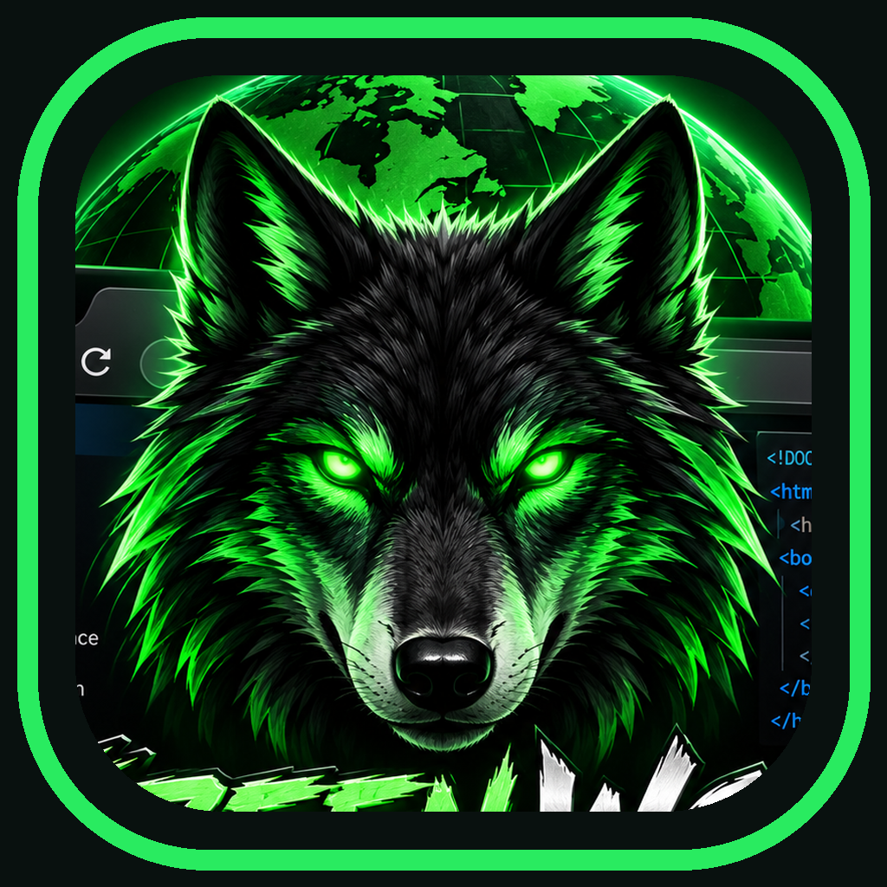

# Green Wolf F12 — Android Developer Browser



**v0.2 Alpha** · Free · No ads · Apache-2.0

Green Wolf F12 is an experimental Android WebView browser with an integrated developer-tools panel. It is **not affiliated with Google or Chrome**.

## Features

- Search/address field and back, forward, reload navigation
- F12 panel dockable to the left, right, top or bottom
- HTML source viewer with syntax highlighting
- JavaScript console, including commands executed in the current webpage
- Observed network requests, HTTP errors, filtering and Preserve option
- Basic DOM editing using a CSS selector, attribute or `textContent`

## Build on Kali Linux

Requirements: Android SDK 35, JDK 17 or 21, Gradle 8.9+ (8.13 tested by the project author on Kali).

```bash
export JAVA_HOME=/usr/lib/jvm/java-21-openjdk-amd64
export PATH="$JAVA_HOME/bin:$PATH"
~/Downloads/gradle-8.13/bin/gradle clean assembleDebug
adb devices
adb install -r app/build/outputs/apk/debug/app-debug.apk
adb shell monkey -p org.greenwolf.f12 1
```

If an earlier install uses a different signing key, Android may reject an update; back up relevant data before uninstalling.

## Limitations / privacy

- **Alpha software**: not yet validated as a production-grade secure browser.
- Network panel displays requests observed by WebView, **not full packet capture**. Successful HTTP status codes and response bodies are generally unavailable through this callback; unknown statuses are marked `?`.
- Elements panel currently shows source HTML rather than a full interactive DOM tree. Basic selector-based editing is available.
- No ad SDK, app analytics, accounts or remote backend. Visited websites may contain their own ads, trackers and scripts.
- JavaScript entered into the console executes on the current page. Use on sites you trust or have permission to test.
- No complete tab management, downloads, hardened browsing or comprehensive permissions UI yet.

## License

Apache License 2.0 — see [LICENSE](LICENSE).
